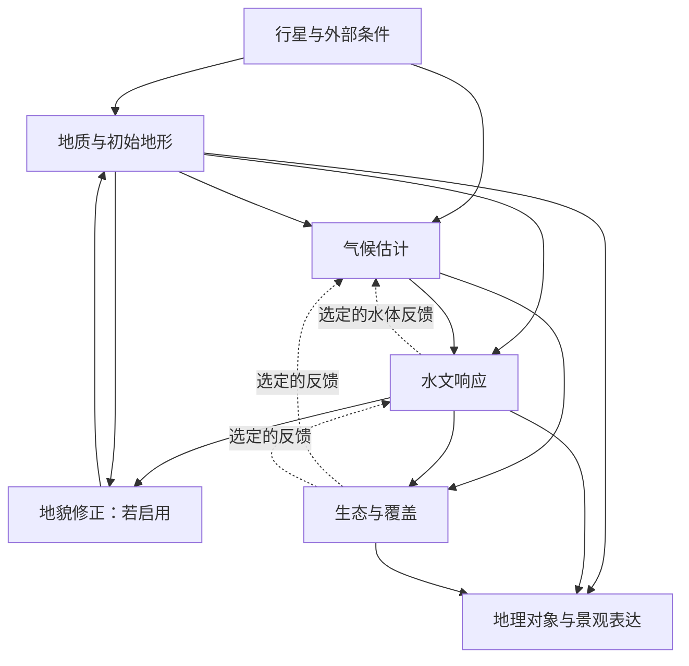

# 自然系统耦合与模型边界

> **文档状态**
>
> - 文档类型：总体架构
> - 决策状态：部分确认
> - 实现状态：未实现
> - 版本：0.1
> - 说明：用于约束自然模块职责、主要依赖和允许的简化边界。

本文用于共同确定世界生成的内容、真实性目标、模块职责及简化边界。它不授权进入实现，不冻结算法、参数、分辨率或验收阈值；历史原型的实现方式也不自动成为最终设计。

关联：[引擎核心设计](../早期设计/引擎核心设计.md) · [科学模型与验证规范](科学模型与验证规范.md) · [术语解释](术语解释.md)。

## 1. 我们要解决的问题

地形、气候、水文、岩性和生态既相互影响，也有不同的作用尺度。若把它们完全拆开，容易生成相互矛盾的世界；若要求一次完整求解，又会使计算、验证和调试失去可控范围。

本项目拟采用的原则是：**先确定必要的因果关系与约束，再选择足以表达这些关系的模型。** 每个被简化或省略的反馈都应被明确记录。

本阶段首先回答“世界需要解释什么”，然后才讨论“用什么算法解释”。

## 2. 决策状态与真实性目标

### 2.1 已确定的产品方向

- 默认输入种子，高级选项允许调整偏好。
- 面向类地行星，先建立板块与地壳骨架，再推导地势和海陆。
- 第一版采用固定类地背景，以统一行星基本条件下的地理布局产生多样性；具体参数数值与高级生成偏好另行确定。
- 独立引擎核心与桌面应用分离，面向 Windows、macOS。
- 支持连续缩放的产品体验，为局部三维结构预留空间。
- 最终生成可探索的固定世界；生成过程可以包含演化计算。
- 主要用途为地图探索与观察；第一版深入地貌级，为场景级预留空间。
- 自然合理性优先，不要求每颗行星包含全部景观；景观需满足选定模型中的形成条件，未模拟或验证的成因明确标注。
- 当前工作仅进行讨论、推导和文档记录，实施需另行明确提出。

已确认“固定地理骨架＋可切换的代表性季节状态”。这不要求所有自然过程静止或平衡，也不要求探索时连续推进时间。季节状态应共享同一地形与对象身份；季节数量、取样时刻及变化变量仍待细化，不强制所有地区都表现为春夏秋冬。

### 2.2 建议采用，尚待确认的质量目标

| 层次 | 建议要求 | 不等于 |
| --- | --- | --- |
| 基础一致性 | 单位、边界、状态和适用的收支约束不自相矛盾 | 仅守恒就真实 |
| 成因可信 | 主要地理现象满足明确的形成条件，模块关系可解释 | 完整复现地球历史 |
| 地理表现可信 | 生成形态和空间关系符合选定世界类型的验证要求 | 只凭图片漂亮验收 |
| 跨尺度一致 | 局部细节服从全球骨架和区域连接 | 无限细节、无限精度 |

暂不以现实灾害预测、工程设计或完整地球系统模拟作为产品目标。是否需要某类局部现象达到更高精度，应针对场景单独讨论。

## 3. 规则的四个层级

| 层级 | 示例 | 项目中的处理方式 |
| --- | --- | --- |
| 硬约束 | 单位一致；交换不重复记账；不产生非法负储量 | 明确检查范围，违反时不发布为有效结果 |
| 有条件的过程模型 | 给定供水、边界和容量关系后的湖泊计算 | 必须登记前提、输入、方程、参数和失效条件 |
| 生成近似 | 用简化构造事件生成山带，用统计规则补充细节 | 标为启发式，不能冒充完整物理求解 |
| 分类与表现 | 根据底层属性识别山林、河滩；选择配色与名称 | 不得未经重新计算直接修改物理状态 |

硬约束同样需要正确限定。例如，“所有水都必须最终入海”不是通用硬约束；“水流只看地面高低”也不能用于任意地下水和回水情景。应检查所选模型中的势能、水位、边界与连接，而非把一句常识推广到所有场景。

生成偏好作用于允许调整的条件或先验。“更多湖泊”不能通过凭空增加水量实现；若偏好与边界条件无法同时满足，应说明冲突，或在已约定范围内重新采样。

## 4. 系统职责与交换接口

以下是职责划分提案，不代表所有过程都纳入首版。

| 模块 | 负责解释 | 主要输入 | 主要输出 | 不应自行决定 |
| --- | --- | --- | --- | --- |
| 行星与外部条件 | 世界运行的基本背景 | 类地预设、用户允许的偏好 | 半径、重力、时间约定、辐射与自转等边界 | 每个区域的具体地貌 |
| 构造与地质 | 大尺度骨架和材料条件 | 行星背景、生成历史或事件 | 构造结构、岩性与地壳属性、地形初态 | 直接指定某地永久湿润 |
| 地形与空间 | 表面形态、邻接和尺度映射 | 构造结果、地表修正 | 高程、坡面、盆地、海岸及空间关系 | 仅按低洼程度决定实际湖水量 |
| 气候 | 区域与季节环境 | 外部条件、海陆、地形；选定的反馈量 | 温度、降水、蒸发需求等适用变量 | 不经水文计算指定湖泊终态 |
| 水文 | 水的储存、交换和输送 | 气候输入、地形、材料参数、初始水量 | 河流连接与通量、湖水、土壤水、地下水等启用状态 | 无依据改变岩性或造山 |
| 地貌演变 | 被启用过程下的地表变化 | 地形、材料、水文或其他动力条件 | 侵蚀、沉积及更新后的地形 | 把形态噪声解释为定量侵蚀 |
| 生态与覆盖 | 植被等地表覆盖条件 | 气候、水分、土壤、地形 | 覆盖类型与属性 | 用美术需求覆盖不相容的环境条件 |
| 特殊地貌与地下空间 | 局部结构及其成因约束 | 岩性、构造、地表与地下水等必要条件 | 洞穴、暗河、天坑等对象与连接 | 默认每个区域都可生成所有地貌 |
| 分类、命名与展示 | 将数据转为可理解的景观 | 上述状态、对象及证据 | 标签、名称、图层、查询解释 | 反向伪造物理量以适配标签 |

建议将空间基础与水量等状态设为单一权威数据源。不同模块可以保存派生结果，但不能分别维护互相冲突的湖面或海岸。

### 4.1 每条交换关系应具备的信息

- 变量定义和单位：储量、速率、累计量或统计量不能混用。
- 空间范围：单元、坡面、流域、整颗行星，以及实际面积。
- 时间含义：瞬时值、步平均、月累计或多年统计。
- 数据来源与版本：模型求得、外部给定还是随机生成。
- 有效范围与缺失状态：未知不能自动当成零。
- 更新规则：由谁计算、何时失效、哪些下游结果需要重算。
- 若为物质交换，明确双方记账关系及系统边界。

例如，“蒸发需求”是外部条件；“实际蒸发量”还受可用水量等所选模型条件限制。接口不应将二者合并成同一个字段。

## 5. 如何处理相互影响

### 5.1 建议的分阶段计算框架

图中的反馈表示待选择的关系，不表示全部同时求解。每个最终输出还应携带状态和验证记录。

### 5.2 耦合等级提案

| 等级 | 做法 | 适合先解决的问题 | 必须承认的限制 |
| --- | --- | --- | --- |
| C0 外部给定 | 使用固定温度、有效径流或其他边界 | 验证一个独立过程 | 不能解释这些输入的来源 |
| C1 单向传递 | 固定地形，气候计算后驱动水文 | 世界大尺度环境与排水关系 | 水体等结果不反过来更新气候 |
| C2 选定反馈 | 只对约定的重要交换量重复更新 | 大水体等反馈是否值得加入 | 需控制迭代、依赖和失效范围 |
| C3 演变反馈 | 地表改变后重算受影响的气候和水文 | 侵蚀沉积与地貌形成 | 成本和验证范围明显增加 |

**建议先讨论 C1 是否足以满足第一版内容，再逐项选择 C2。** C3 可先用于有限区域或受控过程。耦合等级更高不自动代表结果更真实，仍取决于模型、参数和验证证据。

### 5.3 时间与尺度必须分开

建议分别描述构造或生成阶段、地貌演变阶段、气候统计周期、水文时间步和展示时刻。暂不填写固定数值。

在一次气候—水文计算中固定地形，是计算设计约定，不是否认自然反馈。如果之后修正地形，应重新检查海陆、流域、出口和相关气候状态。

长期统计量不能未经说明代替短时过程输入。跨网格交换水量应保持收支，类别、河网连接和地形形态则使用各自的映射规则。

### 5.4 迭代并不保证得到唯一合理世界

反馈求解需要登记初始状态、更新顺序、松弛或其他稳定措施、停止指标和计算上限。

应区分：

- 固定点迭代：检查选定变量及收支残差是否满足条件。
- 季节或时间演化：允许正常变化，检查目标时段、周期性要求或规定的停止状态。
- 随机生成搜索：检查约束是否满足，不能把重抽次数叫作物理时间。

达到迭代上限不等于收敛。不同初态得到不同结果时，应分析是否属于模型允许的多种状态，而不是一律视为程序错误或强行取平均。首版停止指标、容差和失败处理均待讨论。

### 5.5 模拟深度的具体讨论方案（Q07，未确认）

建议将生成工作分为三个阶段，而不是让所有自然系统同时修改同一组数据。

| 阶段 | 负责产生什么 | 允许改变什么 | 约束 |
| --- | --- | --- | --- |
| 世界骨架 | 构造、材料分布和大尺度地形初态 | 山系、盆地、海陆候选布局 | 用受约束的生成规则，不宣称重演完整地史 |
| 环境与状态 | 选定气候模型及水文模型下的季节状态 | 温度、供水、储水、积雪等实际启用变量 | 在一次求解中固定地形；跨季节存储变化须有一致依据 |
| 地貌细化与表达 | 可观察的地貌形态、覆盖及标签 | 满足上游约束的细节；必要时提出地形修正 | 影响排水或气候的修正必须使相关结果失效并重算 |

拟采用的权限原则：地形提供容器和通道，水文决定实际水量与水位，分类读取结果。地形模块不能仅凭发现洼地就宣告那里必定有湖；展示模块不能为了增加湖泊而单独画入没有水量依据的水面。

湖泊示例的建议依赖链：先确定盆地与出口条件，再给定或计算水源和蒸发等启用边界，求得水量与水位，最后确定各代表季节的湖面和湖岸。若细化改变出口高程，需要重新求得受影响的水位和下游状态。这是候选模块契约，不是已选择的具体湖泊公式。

首版反馈选择提案：优先保证已启用水文过程内部的库容、水面面积、实际蒸发和季节储量关系；湖泊或植被反向改变区域气候、侵蚀长期改写山系等关系逐项评估，未启用时记录为省略反馈。此提案尚未确定最终耦合等级。

积雪与融雪已确定为首版需要显式考虑的过程。它们应作为水量状态参与季节计算：寒冷时段，部分降水暂存为雪水当量；温度或其他选定的融化条件满足后，雪储量转为坡面、河流或湖泊入流。积雪不能只作为覆盖颜色，融雪也不能绕过水量账本直接提高河流流量。具体雪水当量、冻结阈值、融雪速率、再冻结、冰川和冰盖是否纳入仍待讨论。

该决定优先服务雪原、高山河流、季节湖泊和寒冷区域探索，不要求首版模拟冰晶微观过程或长期冰川动力学。若某地区没有足够低温或固态降水条件，不能仅为增加雪景而强行添加积雪。

河网已确定需要支持一水多路关系，包括分流、河中岛、湿地漫流和三角洲。水文连接应使用有向图而不是单一树：节点可汇合，也可将水分配给多个下游路径；每个时段的分流量之和必须等于进入该节点后按已启用损失与储量变化可供分配的水量。分流比例可以依赖地形、水位、河道条件或材料，但不能仅为画出更丰富的河网而任意指定。

河中岛、湿地漫流和三角洲属于不同的形成环境：河中岛通常依赖宽河道、分流和沉积／侵蚀条件；湿地漫流依赖低坡度、滞水和水位状态；三角洲还依赖入海边界、沉积物和海岸过程。首版支持它们作为受条件约束的对象与连接关系，不自动承诺完整输沙、潮汐、河道迁移或长期三角洲演变。

代表季节必须描述同一个世界。可以通过时间积分或其他可验证的简化方式获得，但不能各季节独立随机制造湖水或积雪。相邻代表状态之间的转换方法、内部计算时间步和初始条件尚待选择。

需共同决定的核心是：是否接受“关键关系与选定过程计算，漫长历史与部分形态采用有条件的近似生成”。即使接受这一原则，每个模块仍需单独登记具体近似，不能据此任意简化。

## 6. 内容范围：先确定“表达什么”

已确认首版以地表探索为主，深入地貌级；地下内部暂表达位置、范围和连接关系，不要求进入漫游。普通地貌与水体表达具体形态及关系，植被等覆盖表达区域差异而非逐株实例。特殊地貌具体选项、成因条件和精细程度仍待专题讨论。

原始景观词汇并不全是互斥地形类别，建议按属性或对象分层组织。

| 内容组 | 示例 | 讨论重点 |
| --- | --- | --- |
| 地形结构 | 山岭、山峰、山崖、河谷、峡谷、岛屿 | 形状、尺度和连接，需要何种成因解释 |
| 位置与关系 | 山巅、山腰、江岸 | 相对哪个对象定义，是否允许重叠标签 |
| 水体与过程特征 | 大河、溪流、湖泊、瀑布、涌泉 | 常年或季节性，状态和供水证据 |
| 岩性相关特殊地貌 | 溶洞、天坑、石林、岱崮 | 材料和结构条件，需要表面还是体积模型 |
| 地表覆盖与环境组合 | 大漠、戈壁、草原、山林、竹林、雪原 | 地形、气候、材料和覆盖各自承担什么含义 |
| 复合湿地与岸带 | 沼泽、滩涂、河滩、海滩 | 所需时间变化和水位边界是否已被建模 |
| 氛围与景观描述 | 烟岚、云岫 | 属于可变天气、展示状态还是地理属性 |

本表只示范分类方法，不缩减原始需求；完整景观范围仍以现有科学验证规范为依据。首版大类和地表／地下边界已有确认；具体对象、特殊地貌选项及精度仍待细化。

建议每个景观说明：必要条件、促进条件、排除条件、生成尺度、所属对象、依赖模块及未建模的成因。条件满足仅表示允许生成，不代表必须生成。

## 7. 模型准入说明卡

后续每个模型或重要生成规则都应填写下列内容，并与科学验证规范中的模型登记表对应，不另建互相冲突的定义。

| 项目 | 要回答的问题 |
| --- | --- |
| 目的 | 解释什么现象，服务哪些景观或用户需求？ |
| 输入与输出 | 单位、位置、时间与缺失值含义是什么？ |
| 依据 | 哪些是自然过程依据，哪些是工程近似？ |
| 假设 | 固定了什么，忽略了哪些反馈？ |
| 参数 | 来源、允许范围、不确定性及可调偏好是什么？ |
| 初始与边界条件 | 水和能量等从哪里进入、离开，外部库是否更新？ |
| 验证 | 用什么独立参照，何种结果算失败？ |
| 适用与失效 | 哪些尺度、环境或状态不能使用？ |
| 依赖与更新 | 上游变化后谁必须重新计算？ |
| 状态 | 候选、启发式、已实现、已验证到哪个范围？ |

说明卡不完整的模块可以用于明确标注的实验，不能直接升级为正式“科学正确”能力。

## 8. 验证与发布边界

| 检查层次 | 示例 | 不能证明什么 |
| --- | --- | --- |
| 实现与数值 | 手算、解析解、单位、收支、异常回滚 | 模型必然适合真实世界 |
| 条件响应 | 控制其他条件后测试输入变化、阈值事件和反馈 | 任意环境中的响应方向都一样 |
| 现实或统计有效性 | 与独立地理数据、案例或明确目标分布比较 | 单一案例可代表整颗行星 |
| 复现与尺度 | 种子、版本、平台、网格细化和探索顺序检查 | 粗细结果必须每一点完全相同 |

必须单独考虑耦合误差：组件各自通过不表示组合通过。组合测试还应检查交换单位、时间错位、重复供水、遗留状态、反馈振荡及跨尺度收支。

建议发布规则：硬约束失败时停止输出为有效世界；可选模块未通过时，只能采用事先约定、明确记录的降级方案。不能静默用随机纹理替换失败过程，仍宣称成因已经模拟。

## 9. 现有原型在本框架中的位置

- 随机地形：构造启发式及连续纹理，尚非完整地质演化。
- 全球水文参考态：外部有效径流与满蓄假设，不解释降水来源。
- 有限水量演化：干地起始、统一有效供水和湖面蒸发，可测试湖盆过程；仍主要属于 C0。
- 球体查看器：表现层，不增加模型精度；界面回放也不代表真实气候已建立。
- 现有数值测试：提供部分实现与一致性证据，不能替代现实有效性验证。

具体状态以 [随机地形记录](../历史记录/随机地形原型记录.md)、[全球水文参考态](../历史记录/全球水文参考态记录.md)、[有限水量演化记录](../历史记录/有限水量与湖泊演化记录.md) 为准。本讨论稿不改变这些报告的结论。

## 10. 共同决策清单与沟通顺序

以下记录当前决策状态；除明确确认的方向外，不默认采用推荐选项。

| 编号 | 待确定的问题 | 建议讨论方式 |
| --- | --- | --- |
| D01 | 已确定以地图探索与观察为主，第一版深入地貌级 | 全球与区域保持连续一致，场景级预留；具体对象与精度待定 |
| D02 | 首版大类与地表／地下表达边界已确认 | 特殊地貌细项、形成条件及可观察结果继续细化 |
| D03 | 已确定固定地理骨架＋代表性季节切换 | 细化状态数量、变化变量与跨季节一致性；不要求连续时间展示 |
| D04 | 已确定第一版采用固定类地背景 | 具体预设数值与高级生成偏好仍待细化 |
| D05 | 气候需要解释到什么程度？ | 对照景观需求选择变量与统计周期 |
| D06 | 首版启用哪些反馈？ | 按缺失反馈是否影响目标景观作取舍 |
| D07 | 海洋、总水量与海平面怎样关联？ | 区分外部固定海平面与闭合水量需求 |
| D08 | 地貌历史需要真实时长吗？ | 区分过程演化、事件生成与形态约束 |
| D09 | 允许多少计算时间和存储？ | 在内容确定后比较精度与成本 |
| D10 | 什么结果必须判为不合理？ | 给出失败例与独立验收证据 |

D01、D02 的大类边界及 D03 的时间方案已确认，细项仍待补充。D04 已确认固定类地背景；自然合理性优先于景观齐全也已确认；接下来明确模拟深度与简化边界，再逐步确定气候模型与反馈。暂不要求一次回答全部问题。

后续每次确认记录“决定、理由、影响范围、仍未解决的问题”，再更新关联设计；修改旧决定时保留变更理由。未经确认的建议保持待定，不因文档篇幅或原型已经存在就视为承诺。
